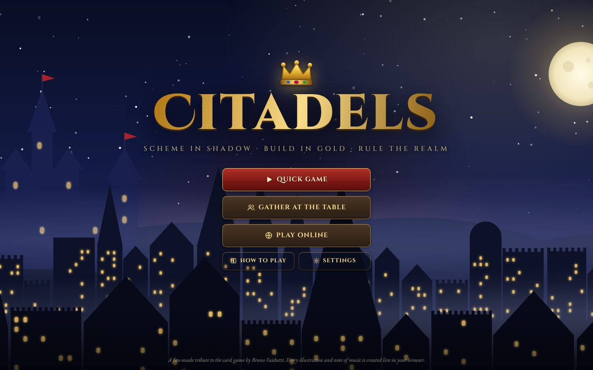
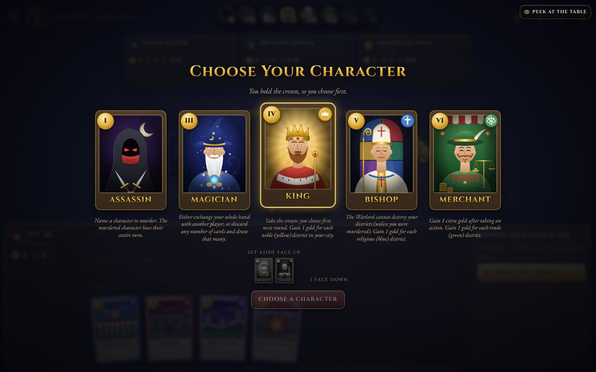
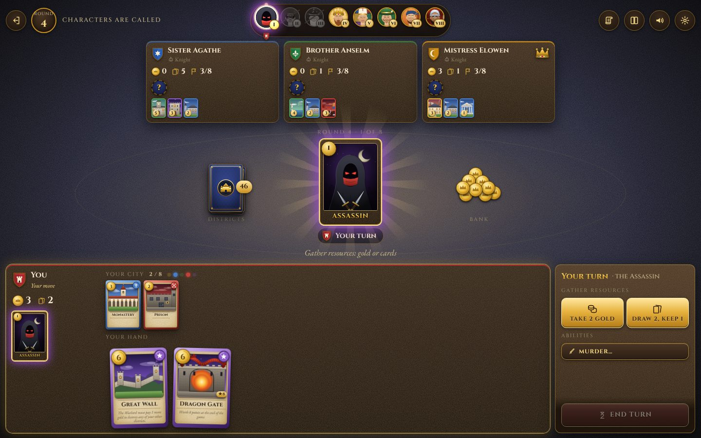
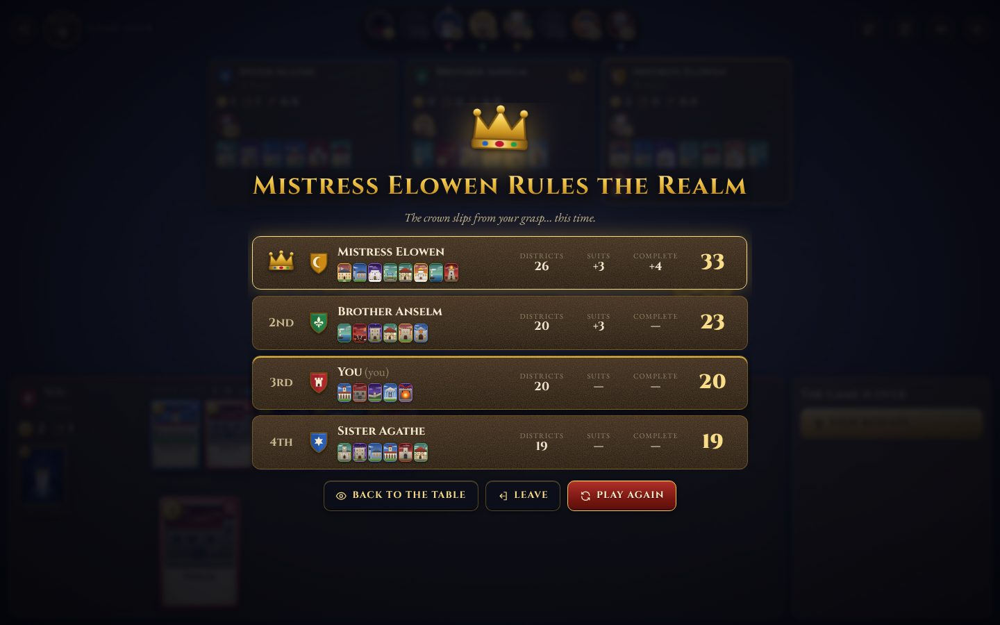

# Citadels

A web edition of the classic city-building, character-bluffing card game. Play **hot-seat with friends on one device**, **against bots**, or **online with a friend code** — all in the browser.

Every illustration is hand-built SVG and every sound (including the music) is synthesized live with the Web Audio API. There are no image or audio files in this repository.



| Choosing a character | The table |
| --- | --- |
|  |  |



## Features

- **Complete classic rules** for 2–7 players: the secret character draft (including the special 2-, 3- and 7-player rules), all eight characters, the 66-card district deck with the eleven unique (purple) districts, the five-suit bonus and end-of-game scoring. The city goal (6, 7 or 8 districts) is configurable.
- **Three ways to play**
  - *Quick Game* against three bots in one click.
  - *Gather at the Table*: any mix of humans sharing a device and bots. Private cards are hidden between turns with a "pass the device" screen.
  - *Play Online*: host a table, share the 5-letter friend code or an invite link (`/join/CODE`), fill empty seats with bots, chat, and rematch. Refreshing or briefly losing connection returns you to your seat; if you're gone too long (or idle past the optional turn timer) a bot plays for you until you're back.
- **Bots in three temperaments** — Squire (easy), Knight (normal) and Lord (hard). Bots only ever see their own view of the game, exactly like a human. Lords think ahead: before choosing a character they imagine dozens of possible hidden hands and character assignments consistent with what they've seen, play the round out in their head, and take the most promising option (in testing they win about 85–90% of games against a table of Knights).
- **Art & sound**: illustrated characters and districts, an animated night skyline with parallax, flying coins and cards, crumbling districts, banners and confetti; synthesized coin clinks, card flicks, church bells, brass fanfares and a generative lute-and-recorder soundtrack.
- **Quality of life**: a narrated chronicle of every move, rules reference built from the game data, card previews on hover (or long-press on touch screens), keyboard shortcuts (`G` gold, `D` draw, `E` end turn, `L` chronicle), volume controls and a reduced-motion mode. Works on phones too.

## Running it

Requires Node.js 20 or newer.

```bash
npm install
npm start          # http://localhost:3000
```

`npm run dev` restarts the server when files change. `npm test` runs the test suite (rules engine, bots, game host and the online server over real WebSockets).

Configuration is through environment variables:

| Variable | Default | Purpose |
| --- | --- | --- |
| `PORT` | `3000` | HTTP/WebSocket port |
| `HOST` | `0.0.0.0` | Interface to bind |

`GET /healthz` returns `{ ok, rooms, players }` for health checks.

## Deploying

The app is a single Node process that serves the static client and the WebSocket game server from the same origin, so any host that runs Node (or Docker) and supports WebSockets will do.

- **Docker**: `docker build -t citadels . && docker run -p 3000:3000 citadels`
- **Render**: `render.yaml` is a ready-made blueprint (New → Blueprint → pick this repo).
- **Railway / Heroku-style hosts**: the `Procfile` runs `npm start`; they provide `PORT` automatically.
- **Fly.io**: `fly launch` detects the Dockerfile; expose internal port 3000.

Online tables live in server memory. Run **one instance** (or use sticky sessions) — a restart ends games in progress. Local and bot games run entirely in the browser and don't touch the server.

## How the code is organised

```
shared/            Isomorphic game code — runs in the browser and on the server
  content/         Data: characters, districts, editions (draft rules, scoring), suits
  engine/          Pure rules engine: createGame / applyAction / getView
  bots/            Bot strategy (works from a player's view only)
  host/GameHost.js Drives one game: applies actions, paces bots, autopilot, turn timer
  protocol.js      WebSocket message types and input sanitising
server/            Express + ws: static files, rooms with friend codes, reconnect tokens
client/
  index.html, styles/
  js/art/          SVG art: portraits, districts, icons, crests, skyline
  js/audio/        Web Audio engine, synthesized effects, generative music
  js/core/         DOM helpers, router, settings, storage
  js/ui/           Cards, buttons, modals, rules and settings dialogs
  js/sessions/     LocalSession and OnlineSession (same interface)
  js/screens/      Title, local setup, online lobby
  js/game/         The table: seats, track, spotlight, hand, actions, overlays, effects
tests/             node:test suites
```

The key idea is that **the game is a plain, JSON-serialisable state plus a pure reducer**:

- `createGame({ players, options, seed })` builds the state.
- `applyAction(state, seat, action)` validates and applies one move (rolling back on any error).
- `getView(state, seat)` returns what one seat may see — hidden cards removed — plus the list of `legal` moves.

The client UI and the bots both consume views, so neither can cheat. `GameHost` wraps the engine for both local and online play, and both session types expose the same events (`view`, `handoff`, `actionError`, …), so the game screen doesn't know or care where the game is running.

## Extending the game

Everything is data-driven through the registry in `shared/content/registry.js`:

- **A new district**: add an entry to a file in `shared/content/districts/` (cost, suit, count, text). Passive effects use flags such as `drawBonus`, `keepBonus`, `indestructible`, `wallBonus`, `wildIncome`, `wildScoring`, `points`; an active ability is an `action` object with `available(ctx)` and `apply(ctx, payload)`. Then draw its picture in `client/js/art/districts.js` (`DISTRICT_ART[id]`).
- **A new character**: register an object with `rank`, `income`, `buildLimit`, lifecycle hooks (`onCalled`, `afterAction`, `onRoundEnd`) and `abilities` whose `input` is `character`, `player`, `district`, `cards` or `none`. The action panel and targeting overlays are generated from that description. Add a portrait in `client/js/art/characters.js`.
- **A new edition / expansion** (e.g. Dark City): call `registerEdition` with its character list, district deck, draft rules per player count and scoring bonuses.
- **Hooks API**: content code changes the game only through the `ctx` object from `shared/engine/context.js` (`gainGold`, `drawCards`, `destroyDistrict`, `log`, …).
- **Bots**: per-ability strategies live in `ABILITY_STRATEGIES` in `shared/bots/bot.js`; difficulty levels are entries in `BOT_LEVELS`. `shared/bots/determinize.js` samples hidden information consistent with a view and `shared/bots/lookahead.js` compares candidate moves by simulation — reuse them for other decisions.
- **Screens**: `registerScreen(name, factory)` in `client/js/core/router.js`.
- **Sounds**: add a function to `SFX` in `client/js/audio/sfx.js` and call `play(name)`; music moods are entries in `MOODS` in `client/js/audio/music.js`.

## Credits

Citadels was designed by Bruno Faidutti. This is an unofficial, non-commercial fan project and is not affiliated with or endorsed by the game's publishers. All code, illustrations and audio in this repository are original and licensed under the Apache License 2.0.
